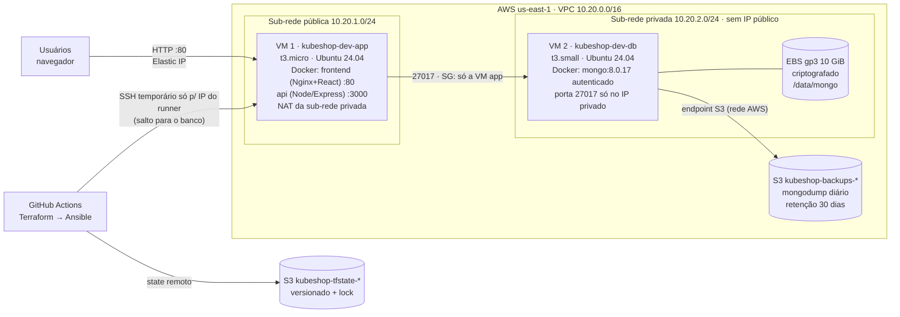

# KubeShop na AWS — Terraform + Ansible + GitHub Actions

Infraestrutura completa para publicar o **KubeShop** (Zibiska Korp) na nuvem, conforme o
documento de escopo (v1.2) e os requisitos do **PM-04 — Projeto Final**.

- **Aplicação** sem alterações: o código e o visual vêm do repositório original
  [`LaercioMLB/kube-shop-v2`](https://github.com/LaercioMLB/kube-shop-v2), construídos com os
  Dockerfiles dele próprio.
- **Duas VMs** na AWS (`us-east-1`): VM 1 com o frontend React/Nginx e a API Node.js/Express, e VM 2 **exclusiva** do MongoDB,
  em **sub-rede privada sem IP público**.
- **Terraform** provisiona a rede, as VMs, os Security Groups, o volume EBS de dados, o IAM e o bucket de backups.
  O state fica remoto no S3, com versionamento e lock.
- **Ansible** cuida do SO, dos pacotes, do hardening de SSH, do NAT, do Docker, do MongoDB, dos contêineres, do backup e das verificações.
  É idempotente.
- **GitHub Actions**: pipelines manuais com parâmetros para criar, atualizar, operar, fazer backup, restaurar e desativar.



## Estrutura

```
kubeshop-infra/
├── .github/
│   ├── workflows/
│   │   ├── ci.yml            0 · validação automática (fmt/validate/lint/segredos)
│   │   ├── app-cicd.yml      1 · CI/CD da aplicação (testes, build, GHCR, deploy da tag)
│   │   ├── infra-deploy.yml  2 · provisionar/atualizar (Terraform → Ansible → testes)
│   │   ├── ops.yml           3 · saúde, smoke, logs, reinício, backup, restauração
│   │   └── destroy.yml       9 · desativação (destrutivo, com confirmação)
│   └── actions/              ações reutilizáveis (AWS/Terraform/backend, Ansible/SSH/inventário)
├── terraform/
│   ├── global/               bucket de backups (sobrevive à desativação dos ambientes)
│   └── environment/          VPC, sub-redes, rotas, SGs, 2 VMs, EIP, EBS, IAM (um state por ambiente)
├── ansible/
│   ├── playbook.yml          preparação completa e idempotente das duas VMs
│   ├── playbooks/            rotinas de operação (health, logs, restart, backup, restore, deploy-app)
│   ├── inventory/            group_vars + exemplo (o hosts.yml real é gerado do Terraform)
│   └── roles/                os_updates, packages, hardening, nat_instance, docker,
│                             data_volume, mongodb, backup, containers, verify
├── scripts/                  backend do state, inventário, SSH temporário, smoke e isolamento
│   └── windows/              instalação das ferramentas e configuração do GitHub (1 comando)
├── docs/                     arquitetura, custos, operação, CI/CD, acesso ao banco, validação
└── evidencias/               onde guardar prints e artefatos das execuções
```

## Como executar (resumo)

> O passo a passo completo, com o que depende de você, está em **[docs/00-passo-a-passo.md](docs/00-passo-a-passo.md)**.

1. Crie a conta AWS e um usuário IAM com access key. Veja a seção 1 do passo a passo.
2. No PowerShell, dentro desta pasta:
   ```powershell
   powershell -ExecutionPolicy Bypass -File scripts\windows\install-tools.ps1
   powershell -ExecutionPolicy Bypass -File scripts\windows\setup-github.ps1
   ```
   O script cria o repositório, gera a chave SSH e as senhas do banco e grava tudo como **GitHub Secrets**.
3. No GitHub, vá em **Actions → "2 · Infra - Provisionar / Atualizar" → Run workflow** e use `environment=dev`.
4. Abra a URL **Loja disponível em:** que aparece no resumo da execução.

## Pipelines e parâmetros

| Pipeline | Quando usar | Parâmetros principais |
|---|---|---|
| **0 · CI** | automático a cada push | — |
| **1 · App CI/CD** | nova versão da aplicação | `app_ref`, `image_tag`, `deploy_environment` |
| **2 · Infra** | criar/atualizar ambiente | `environment`, `run_mode` (plan/apply), `instance_name`, `instance_type`, `db_instance_type`, `db_volume_gb`, `docker_image`, `docker_tag`, `update_os`, `extra_packages` |
| **3 · Operação** | rotinas diárias | `action` (health, smoke-test, logs, restart, backup, list-backups, restore, deploy-app), `service`, `backup_key`, `confirm` |
| **9 · Desativar** | encerrar ambiente | `environment`, `confirmation` = `DESTRUIR-<amb>`, `final_backup`, `remove_backup_bucket` |

Como cada parâmetro chega à infraestrutura:

| Parâmetro | Destino | Efeito |
|---|---|---|
| `environment` | Terraform + Ansible | state separado, VPC própria (10.20/10.30/10.40), nomes e tags |
| `instance_name` | Terraform (`TF_VAR_instance_name`) | nome das VMs `<nome>-<amb>-app/db` |
| `instance_type` | Terraform (`TF_VAR_app_instance_type`) | tamanho da VM da aplicação (alteração in-place) |
| `db_instance_type` | Terraform | tamanho da VM do banco (dados preservados no EBS) |
| `db_volume_gb` | Terraform + Ansible | aumenta o EBS online e o `xfs_growfs` expande o disco |
| `docker_image` / `docker_tag` | Ansible (`-e`) | baixa a imagem e recria os contêineres de forma controlada |
| `update_os` | Ansible (`-e`) | `apt dist-upgrade` e reinício só se o SO pedir |
| `extra_packages` | Ansible (`-e`) | instala pacotes adicionais via apt |

## Documentação

| Documento | Conteúdo |
|---|---|
| [00 · Passo a passo](docs/00-passo-a-passo.md) | o que depende de você, execução e roteiro de apresentação |
| [01 · Arquitetura](docs/01-arquitetura.md) | diagrama, decisões, justificativas, segurança, state, limitações |
| [02 · Custos](docs/02-custos.md) | estimativa mensal com premissas e fontes |
| [03 · Manual de operação](docs/03-manual-operacao.md) | cada rotina: parâmetros, resultado esperado e o que fazer em falhas |
| [04 · Integração CI/CD](docs/04-integracao-cicd.md) | pontos de integração da aplicação, segredos (só nomes) |
| [05 · Acesso administrativo ao banco](docs/05-acesso-administrativo-banco.md) | procedimento separado (REQ-03) |
| [06 · Matriz de requisitos](docs/06-matriz-requisitos.md) | REQ/ACE do escopo e critérios do PM-04 → onde são atendidos |
| [07 · Relatório de validação](docs/07-relatorio-validacao.md) | testes executados, evidências e cenários 1, 2 e 3 |

## Segurança dos segredos

- Nenhuma senha, chave ou token fica no repositório. Todos ficam em **GitHub Secrets**: `AWS_ACCESS_KEY_ID`, `AWS_SECRET_ACCESS_KEY` (ou `AWS_ROLE_ARN`),
  `SSH_PRIVATE_KEY`, `MONGO_ROOT_PASSWORD` e `MONGO_APP_PASSWORD`.
- O GitHub mascara os valores nos logs. As tarefas do Ansible que lidam com senhas usam `no_log: true`, e as senhas chegam por variável de ambiente, nunca pela linha de comando.
- Nas VMs, as senhas ficam em arquivos `0400` montados como *secret files* nos contêineres (`*_FILE`), então não aparecem em `docker inspect`.
- O SSH fica **fechado**. A pipeline libera a porta 22 só para o IP do próprio runner durante a execução e remove a regra no final.
- O CI roda **gitleaks** em todo push para impedir segredos versionados por engano.
