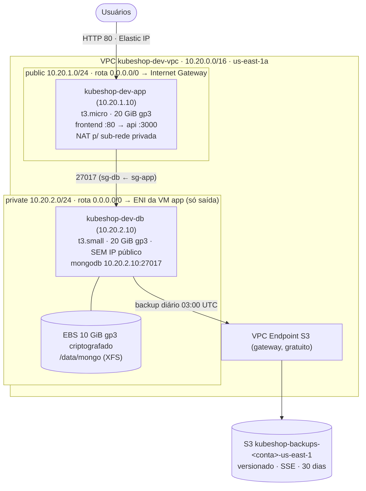

# 01 · Documento de arquitetura

## 1. Diagnóstico da aplicação (etapa 1 do roadmap)

Repositório analisado: `LaercioMLB/kube-shop-v2`, commit `ee30950` (11/11/2026), licença MIT.

| Componente | Imagem/base | Porta | Observações relevantes para a implantação |
|---|---|---|---|
| frontend | `nginx:1.28.0-alpine` + build Vite/React | 8080 | `nginx.conf` encaminha `/api` para o host **`api:3000`** usando o DNS do Docker (`127.0.0.11`). Roda sem root e com filesystem somente leitura. |
| api | `node:24.15.0-alpine3.23` | 3000 | Configurada por `MONGO_HOST`, `MONGO_USERNAME` e `MONGO_PASSWORD_FILE`. `/api/health/ready` testa o banco. Reconecta sozinha. |
| mongodb | `mongo:8.0.17` | 27017 | Inicializado com root (`*_PASSWORD_FILE`). `init.js` cria o usuário `kubeshop` com `readWrite`. O healthcheck autentica. |

No original, os três serviços ficam em um único `compose.yaml` com redes `web` e `data`. Não há CI/CD no repositório
da aplicação. O escopo considera que ele "já existe", e o pipeline **1 · App CI/CD** representa esse fluxo e documenta
os pontos de integração ([04-integracao-cicd.md](04-integracao-cicd.md)).

### Adaptação para servidores separados (seção 5 do escopo)

| Item do compose original | Como ficou com duas VMs |
|---|---|
| `MONGO_HOST: mongodb` (DNS interno) | `MONGO_HOST: 10.20.2.10`, o **IP privado fixo** da VM do banco, definido no Terraform |
| rede `data` interna | rede privada da VPC + Security Group (27017 só a partir do SG da aplicação) |
| `secrets:` do compose | arquivos `0400` em `/opt/kubeshop/secrets`, montados em `/run/secrets/*` e alimentados pelos GitHub Secrets |
| `depends_on: service_healthy` | ordem no playbook: banco saudável → API saudável → frontend (esperas com `until`) |
| volume `mongo-data` | **volume EBS dedicado** montado em `/data/mongo` |
| porta `8080` publicada | frontend publicado em **:80** da VM da aplicação |
| `read_only`, `cap_drop`, `no-new-privileges`, `init`, healthchecks, rotação de logs | mantidos iguais em `docker_container` |

O código e o visual não foram alterados. As imagens são construídas com os Dockerfiles originais.

## 2. Provedor, região e ferramentas

| Decisão | Escolha | Justificativa |
|---|---|---|
| Provedor | **AWS** | Provedor usado nas aulas de Terraform. O plano gratuito com créditos cobre o projeto. Os recursos necessários (VPC, EC2, EBS, S3, IAM) são maduros e têm provider Terraform oficial. |
| Região | **us-east-1** (N. Virginia) | Menor preço da AWS (sa-east-1 custa cerca de 50% a 60% a mais). A latência a partir do Brasil (cerca de 120 ms) é aceitável para a loja de demonstração. A região é um parâmetro (`AWS_REGION`). |
| IaC | **Terraform 1.17** + provider `hashicorp/aws ~> 6.0` | Exigência do PM-04. Declarativo, com plano prévio (`plan`), state e atualização in-place. |
| Configuração | **Ansible** (ansible-core 2.18, `community.docker`) | Exigência do PM-04. Agentless (só SSH e Python, que já vêm no Ubuntu). Idempotente. |
| Pipelines | **GitHub Actions** | O código já está no GitHub. Execução manual (`workflow_dispatch`) com parâmetros, Secrets, ambientes e artefatos de evidência. Gratuito em repositório público. |
| Execução nas VMs | **Docker Engine** | Reaproveita as imagens e as práticas de segurança do compose validado. Atualizar é trocar a tag. |
| SO | **Ubuntu Server 24.04 LTS** (AMI oficial Canonical) | Suporte até 2029, Python 3.12 nativo, repositório oficial da Docker. |

## 3. Arquitetura

### Recursos (inventário, ACE-02)

| Recurso | Nome (dev) | Função |
|---|---|---|
| `aws_vpc` | kubeshop-dev-vpc | rede isolada do ambiente (10.20/16; homolog 10.30/16; prod 10.40/16) |
| `aws_subnet` ×2 | kubeshop-dev-public / -private | aplicação / banco |
| `aws_internet_gateway`, `aws_route_table` ×2 | — | saída da sub-rede pública; a privada só sai pela VM app (NAT) |
| `aws_vpc_endpoint` (S3) | kubeshop-dev-s3-endpoint | backups sem passar pela internet |
| `aws_security_group` ×2 + regras | kubeshop-dev-sg-app / -sg-db | firewall (detalhes abaixo) |
| `aws_instance` | **kubeshop-dev-app** | VM 1: Nginx+React e API em Docker; NAT |
| `aws_instance` | **kubeshop-dev-db** | VM 2: MongoDB exclusivo |
| `aws_eip` | kubeshop-dev-app-eip | endereço público fixo da loja |
| `aws_ebs_volume` + attachment | kubeshop-dev-mongo-data | dados persistentes do MongoDB |
| `aws_iam_role` + instance profile | kubeshop-dev-db-role | a VM do banco grava backups só no prefixo `dev/` |
| `aws_key_pair` | kubeshop-dev-admin | chave pública administrativa |
| `aws_s3_bucket` (stack global) | kubeshop-backups-&lt;conta&gt;-us-east-1 | backups de todos os ambientes |
| bucket de state (script) | kubeshop-tfstate-&lt;conta&gt;-us-east-1 | Terraform State remoto |

Recursos além das duas VMs e por que foram necessários (REQ-01): o **EIP** dá um endereço fixo à loja, o **volume EBS** separa os dados do disco do SO (persistência), o **S3** guarda backups fora das VMs, o **IAM** dá credencial temporária sem chave na VM e o **endpoint S3** é gratuito e mantém o backup dentro da rede da AWS.

### Dimensionamento

| VM | Tipo | vCPU / RAM | Por quê |
|---|---|---|---|
| app | t3.micro (parâmetro) | 2 / 1 GiB | Nginx estático e API Node leve usam menos de 300 MB juntos. O burst da família T3 absorve picos. Pode subir para t3.small no Cenário 2. |
| db | t3.small (parâmetro) | 2 / 2 GiB | MongoDB 8 com `--wiredTigerCacheSizeGB 0.25` (igual ao original). 2 GiB dão folga para o cache do SO e para o `mongodump`. Precisa de AVX, que a t3 (Intel) tem. |
| discos | gp3 20 GiB (SO) + 10 GiB (dados) | 3000 IOPS base | gp3 é a opção mais barata com IOPS garantidas. 10 GiB comportam milhões de pedidos fictícios. |

## 4. Segurança e acessos (REQ-02, REQ-03, REQ-04)

**Security Groups**

| SG | Entrada | Saída |
|---|---|---|
| sg-app | 80/tcp de 0.0.0.0/0 (loja) · 22/tcp **somente** de `ADMIN_CIDRS` (vazio por padrão) e, temporariamente, do IP do runner · 80/443 a partir do sg-db (tráfego NAT) | tudo |
| sg-db | **27017/tcp e 22/tcp somente a partir do sg-app** (referência a SG, não CIDR) | 443 e 80 (atualizações e imagens), 53 para o DNS do VPC |

**Camadas de proteção do banco**
1. A VM não tem IP público e fica em uma sub-rede sem rota de entrada a partir da internet.
2. O SG só aceita conexões vindas do SG da aplicação.
3. O Docker publica a porta 27017 **apenas no IP privado** (`10.20.2.10:27017`), nunca em 0.0.0.0. O Ansible verifica isso a cada execução.
4. O MongoDB exige autenticação. A API usa o usuário `kubeshop` (readWrite só no banco `kubeshop`), não o root. O Ansible prova isso com uma tentativa sem senha, que é **recusada**.

**Acesso administrativo**
- SSH só por chave (`PasswordAuthentication no`, `PermitRootLogin no`, `AllowUsers ubuntu`), aplicado pelo Ansible.
- A porta 22 fica fechada por padrão. A pipeline abre apenas para o próprio IP (`/32`) e fecha no final (`if: always()`), com limpeza defensiva de regras esquecidas.
- O banco só é acessado por salto (ProxyJump) via VM da aplicação. Veja o procedimento em [05-acesso-administrativo-banco.md](05-acesso-administrativo-banco.md).
- IMDSv2 é obrigatório nas duas VMs e os discos são criptografados.
- O `unattended-upgrades` aplica atualizações de segurança diariamente.

**Credenciais da pipeline**: para o laboratório, um usuário IAM dedicado com access key em GitHub Secrets.
A pipeline também aceita **OIDC** (secret `AWS_ROLE_ARN`). Com ele não há chave de longa duração, e é a recomendação para produção.

## 5. Endereço de acesso, DNS e TLS

- **Endereço da loja:** `http://<Elastic IP>`, exibido no resumo da pipeline e no output `store_url`. O EIP é fixo enquanto o ambiente existir.
- **DNS e TLS: não utilizados nesta entrega.** O cliente não forneceu domínio, e um certificado público exige um nome DNS válido.
  A loja é fictícia, sem login nem pagamento, então o tráfego HTTP não carrega dados sensíveis.
  **Para produção:** registrar um domínio (Route 53, cerca de US$ 0,50/mês por zona) apontando para o EIP e terminar TLS com Let's Encrypt
  (um contêiner Caddy ou Certbot na VM app). A alternativa é um ALB com certificado ACM gratuito, que custa cerca de US$ 16/mês.

## 6. Terraform State: armazenamento, proteção e recuperação

| Aspecto | Implementação |
|---|---|
| Armazenamento | bucket S3 `kubeshop-tfstate-<conta>-<região>`, chaves `kubeshop/global/terraform.tfstate` e `kubeshop/<ambiente>/terraform.tfstate` (um state por ambiente) |
| Criação | `scripts/ensure-backend.sh`, rodado pela pipeline de forma idempotente |
| Proteção | acesso público bloqueado, criptografia SSE-S3, política que **nega acesso sem TLS**, acesso só pela conta AWS |
| Concorrência | lock nativo do S3 (`use_lockfile = true`) + `concurrency` do GitHub por ambiente |
| Recuperação | **versionamento** ativo (versões antigas guardadas por 90 dias). Para voltar uma versão: `aws s3api list-object-versions --bucket <b> --prefix kubeshop/dev/` e copiar a versão desejada sobre a atual. Lock preso: `terraform force-unlock <ID>`. |
| Conteúdo sensível | o state **não contém senhas**: as senhas do banco nunca passam pelo Terraform, só pelo Ansible |

## 7. Estratégia de atualização e recuperação de falhas

- **Infraestrutura:** o `plan` aparece no log e no resumo antes do `apply`. `run_mode=plan` permite revisar sem aplicar. Mudanças de tipo de VM são in-place.
  A AMI fica fixada após a criação (`ignore_changes = [ami]`), então uma AMI nova não recria a VM. Os dados ficam no EBS, que sobrevive até à recriação da VM.
- **Aplicação:** imagens com **tag explícita**. Trocar a tag recria só os contêineres. A **reversão** é rodar a pipeline com a tag anterior.
- **Falha no meio da execução:** a pipeline para, e o log e os artefatos mostram a etapa. Como Terraform e Ansible são idempotentes, basta corrigir e reexecutar.
  Se os dados forem afetados, use `3 · Operação → restore`. Detalhes em [03-manual-operacao.md](03-manual-operacao.md#recuperação-de-falhas).

## 8. Limitações conhecidas

- **Instância única** de cada serviço, sem alta disponibilidade. Uma falha da AZ ou da VM derruba a loja até a recuperação (RTO de cerca de 20 min via pipeline 2 + restore).
- **NAT na VM da aplicação**: economiza cerca de US$ 33/mês, mas se a VM app cair, a VM do banco perde a saída para a internet. O banco continua funcionando, só não consegue baixar atualizações.
  Basta `use_nat_gateway = true` no Terraform para usar o NAT Gateway gerenciado.
- **RPO de backup de 24 h** (diário), e o backup sob demanda está disponível. O `mongodump` em instância única não é snapshot transacional, o que é aceitável para o volume de demonstração.
- **HTTP sem TLS** (justificado acima).
- **Rotação de senhas do banco** exige um procedimento manual documentado ([05](05-acesso-administrativo-banco.md#rotação-de-senhas)), porque a imagem do MongoDB só cria os usuários na primeira inicialização.
- **Chave SSH**: trocar o secret não atualiza VMs já criadas, porque a AWS só injeta a chave no primeiro boot. Para trocar, siga o procedimento do doc 05.
- Contas AWS novas podem ter **cota baixa de vCPU**. Os tipos t3.micro e t3.small cabem na cota padrão.
